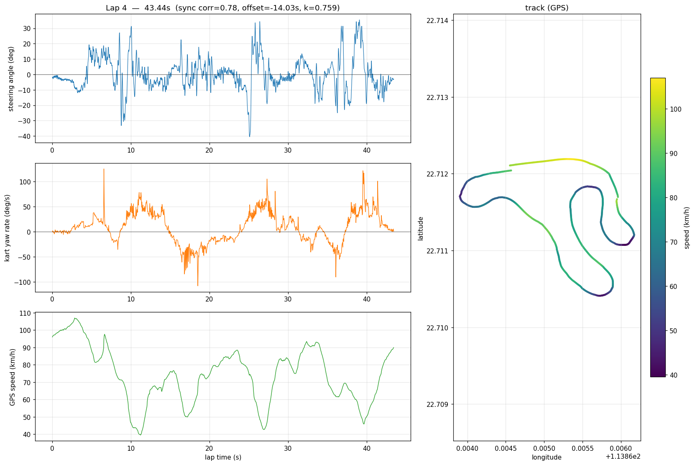
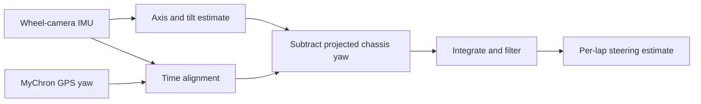
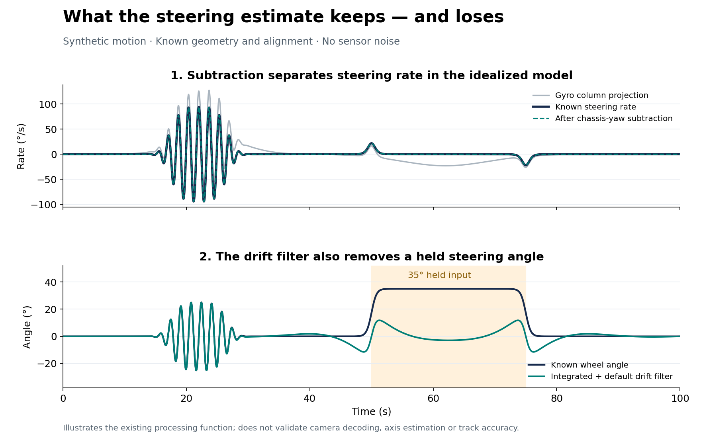

# Kart Telemetry Experiment

**Can a camera mounted on a kart's steering wheel recover the driver's steering input?**

This experiment uses an Insta360 Go 3S gyroscope and an AiM MyChron logger to
separate wheel rotation from chassis yaw, align the recordings, and produce
per-lap plots. It grew out of a practical question: could existing onboard
recordings reveal something useful about driving technique?

**Status: concluded as an exploratory steering study.** The processing pipeline
ran on real track data. Absolute steering accuracy and a benefit to driving
performance were not established. The code and results remain here as a case
study; no further capture or feature work is planned for this experiment.

[Real-session results](RESULTS.md) · [Executed notebook](analysis.ipynb) ·
[Run the example](#run-the-example) · [Validation limits](STEERING_VALIDATION.md)

## A lap from the experiment



*XTreme, 11 May 2026. The steering trace is a filtered estimate; the other
panels come from the logger. This demonstrates the pipeline's output, not
independent steering accuracy.*

The historical run produced six GPS-segmented lap windows. The camera/logger
alignment used a time offset of −14.03 s and reached a normalized correlation
of 0.658. That correlation describes the **alignment signals**, not steering
accuracy. See [the results](RESULTS.md) for the inputs and all six plots.

## The engineering problem

A wheel-mounted gyro rotates with both the steering wheel and the kart.
Integrating it directly mixes those two motions. In the simplified model:

```text
gyro projected onto column = steering rate + k × chassis yaw rate
k = |column axis · vertical|
```

The real-session path estimates the column axis from gyro covariance, uses
quiet accelerometer samples to estimate its tilt, and aligns the camera with
the logger by correlating yaw-related signals. It subtracts the projected
logger yaw rate, integrates the remainder, and removes slow integration drift.



This path **requires the logger**. Geometry estimation assumes wheel rotation
dominates the relevant gyro motion, and the yaw model does not account for
every chassis movement. Filtering suppresses drift but also suppresses sustained
steering, so the output is not an absolute steering-angle sensor.

## Run the example

No camera, logger, private recordings or telemetry decoder is needed for this
deterministic synthetic example. From a clone of this repository, with Python
3.11 or newer:

```bash
python3 -m venv .venv
.venv/bin/python -m pip install -r examples/requirements.txt
.venv/bin/python -m examples.steering_demo --out-dir results/demo
```

Open `results/demo/steering-demo.png`. The command also writes the input and
output traces to CSV and a JSON summary. The checked-in version is below:



The example sends generated motion through the existing
`steering_from_synced` function. **Axis, tilt, bias and clock alignment are
supplied as known inputs.** It demonstrates the subtraction/integration/filter
stage and its limitation on a held steering angle. It does not validate camera
decoding, automatic geometry, synchronization or accuracy on a kart.

### Explore real recordings

The [executed notebook](analysis.ipynb) includes the historical plots and can be
read on GitHub without running it. It retains the historical implementation
snapshot and outputs; `_build_notebook.py` generates a new, unexecuted notebook
from the current modules. Raw recordings are not distributed, so the historical
result cannot be regenerated from a clone alone.

To process your own compatible recordings:

```bash
.venv/bin/python -m pip install -r pipeline/requirements.txt
.venv/bin/python -m analysis.per_lap \
  /path/to/wheel.gyroflow /path/to/session.xrk \
  --all --out-dir results/my_session
```

The `.gyroflow` file must contain the embedded IMU samples. Original Insta360
video input additionally requires the external `gyro2bb` decoder. In the Go 3S
recordings examined here, Pro Video preserved raw gyro and ordinary Video did
not. Preserve originals; re-encoded video is not a substitute for sensor data.

## What the experiment established

- **A working analysis path:** camera IMU ingestion, clock alignment, geometric
  projection, logger-yaw subtraction and lap plots were exercised on real data.
- **A repeatable mathematical demonstration:** the synthetic example makes the
  signal separation visible while showing how drift filtering changes the result.
- **A clear evidence boundary:** there is no completed comparison against a
  calibrated, independent steering reference, and no demonstrated coaching or
  lap-time improvement. Visual plausibility is not calibration.

The project stops here because the next step would be a separate measurement
validation effort, while the original goal was better karting. Preserving the
method and its limits is a useful outcome without that further commitment.

## Explore the repository

| Artifact | Purpose |
|---|---|
| [RESULTS.md](RESULTS.md) | Historical real-session output and interpretation |
| [analysis.ipynb](analysis.ipynb) | Executed walkthrough with embedded plots |
| [examples/steering_demo.py](examples/steering_demo.py) | Runnable synthetic illustration |
| [pipeline/sync_xrk.py](pipeline/sync_xrk.py) | Clock alignment and geometry estimation |
| [analysis/per_lap.py](analysis/per_lap.py) | Steering estimate and lap visualization |
| [STEERING_VALIDATION.md](STEERING_VALIDATION.md) | What remains unverified |
| [ROADMAP.md](ROADMAP.md) | Closeout and disposition of the original scope |

The tests exercise decoding, calibration, synchronization and analysis contracts
with synthetic fixtures. After installing the full requirements, run:

```bash
.venv/bin/python -m pytest -q
```

Experimental tire/vision utilities retained in the repository are outside this
steering case study and are not presented as validated capabilities.
