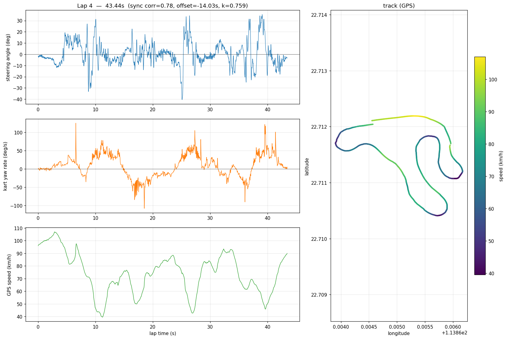

# Historical results — XTreme, 11 May 2026

A historical run of the wheel-camera IMU + MyChron XRK pipeline on a real
driving session. Six GPS-segmented windows were recovered from about nine
minutes of mixed pit/on-track recording, including out/in-lap windows.

**Evidence boundary:** this demonstrates processing, not independently verified
steering accuracy. The raw recordings are not distributed. These results and
the embedded notebook outputs are retained from the original run; the closeout
did not rerun that private session. See [validation limits](STEERING_VALIDATION.md).

## Inputs

| File | Source | Notes |
|---|---|---|
| `PRO_VID_20260511_145850_00_060.gyroflow` | Insta360 Go 3S, wheel-hub mount | 519 s, 1 kHz IMU, 4K video @ 24 fps |
| `a_a_XTreme_a_0619.xrk` | AiM MyChron 5/6 (logger model 787) | 290 s, 32 channels, 25 Hz GPS |

The Go 3S was mounted "horizontal, lens forward/downward to see the
front wing and wheels" — i.e. on the steering wheel hub but at an angle
to the column. This is the project brainstorm's **Mount 2**, harder to
process than the canonical lens-along-column mount because the column
axis isn't aligned with any body axis.

## Sync result

```
offset (IMU → XRK):   -14.027 s
peak |corr|:           0.658             ← alignment correlation, not steering accuracy
sign:                  -1                ← IMU column axis flipped to match GPS convention
column tilt:           40.6° from vertical (k = 0.7588)
```

Notes:
- The Insta360's wall-clock said the recording started 31 s before the
  XRK logger did. The cross-correlation found a 14-second offset
  instead — a 17 s discrepancy between the inferred offset and the timestamps. **Trusting the
  wall-clocks would have produced a misaligned analysis.**
- The column-tilt factor `k = |column · world_up| = 0.7588` is what we
  multiply GPS yaw rate by to subtract chassis yaw from the IMU column
  projection.

## Per-lap summary

| Lap | Duration | Peak estimated steering | Peak yaw rate | Peak speed | Mean speed |
|----:|---------:|--------------:|--------------:|-----------:|-----------:|
| 0   | 54.08 s  | ±64°          | ±309°/s       | 90.9 km/h  | (out-lap)  |
| 1   | 44.56 s  | ±43°          | ±161°/s       | 107.1 km/h | ~70 km/h   |
| 2   | 44.32 s  | ±74°          | ±263°/s       | 108.6 km/h | ~70 km/h   |
| 3   | 44.64 s  | ±57°          | ±267°/s       | 108.6 km/h | ~70 km/h   |
| **4** | **43.44 s** | **±41°**  | ±125°/s       | 106.9 km/h | ~70 km/h   |
| 5   | 49.48 s  | ±55°          | ±381°/s       | 108.5 km/h | (in-lap)   |

**Lap 4 has the shortest detected duration** (43.44 s) and the smallest peak
estimated steering magnitude among these windows. This single-session
association does not show that smaller steering inputs caused a faster lap,
or establish which lap was driven best.

Lap 0 is a warm-up (lower peak speed, larger peak yaw rate from a GPS
fix wobble). Lap 5 ends with a slowdown to the pit. The four genuine
hot laps (1-4) are tightly grouped within 1.2 seconds of each other,
suggesting a consistent driver.



See [`results/session_20260511_xtreme/`](results/session_20260511_xtreme/) for all six lap PNGs.

## What we found along the way

**This Go 3S recording carries IMU samples at 1 kHz.** Initial assumption was wrong
by 5×; corrected in code.

**Quiet samples gave a small estimated gyro bias** in this session, about
0.01°/s on the wheel-rotation axis. That estimate is not a substitute for a
controlled calibration or a measurement of stability across sessions.

**The logger's beacon markers were incomplete in this recording.** The XRK marked
only 2 laps in 290 s of driving; the second "lap" actually contained
6 physical laps fused. GPS return-to-start detection supplied the six windows used here. Its
25 m threshold produces approximate boundaries, not official lap timing.

**Device timestamps did not agree with the fitted alignment.** Correlating
yaw-related signals gave an alternative offset. This run does not establish
a clock-drift rate or guarantee that the same alignment method works on every
recording.

**XRK `GPS Speed` is in m/s, not km/h.** Always check units; we got
this wrong on the first pass.

**PCA supplied a candidate column axis.** This assumes steering rotation
dominates the relevant covariance. Combining that axis with the quiet-sample
tilt estimate and logger yaw produced plausible-looking traces. Their shape
and near-zero straight sections are not proof of correctness, particularly
because the final high-pass filter removes slow components.

## Methodology — one paragraph

For each session:

1. **Sync** — Cross-correlate the IMU's column-axis projection
   (low-pass filtered at 0.3 Hz to isolate chassis yaw) against the
   XRK's `GPS_Yaw_Rate` channel. Returns clock offset, sign, and
   peak correlation as a confidence metric.
2. **Geometry** — Detect the column axis via PCA of the gyro
   covariance matrix. Compute the column tilt factor
   `k = |column · world_up|` from the gravity vector in quiet samples.
3. **Steering input** —
   `ω_steering = (gyro − bias) · column_axis − k · GPS_Yaw_Rate`.
   The stored axis already includes the fitted sign; do not apply it twice.
   Integrate, light HP filter for residual drift cleanup.
4. **Lap segmentation** — Prefer XRK beacon markers if they look
   sensible (>2 markers, no lap >120 s). Otherwise GPS return-to-start.
5. **Plot** — Per-lap PNG with steering angle, kart yaw rate, GPS speed,
   GPS track overlay colored by speed.

All implementation in [`pipeline/sync_xrk.py`](pipeline/sync_xrk.py)
and [`analysis/per_lap.py`](analysis/per_lap.py).

## Running the same path on your own recordings

The private source files are required to regenerate this particular historical
result. For an example runnable from a fresh clone, use the
[synthetic demo](README.md#run-the-example).

```bash
python3 -m venv .venv
.venv/bin/pip install -r pipeline/requirements.txt

# Export a .gyroflow project file from Gyroflow for the wheel-cam video
# (open the video → File → Save → save next to the .mp4).

.venv/bin/python -m analysis.per_lap \
    /path/to/wheel.gyroflow \
    /path/to/session.xrk \
    --all --out-dir results/my_session/
```

Timing depends on the source format, decoder and machine.
